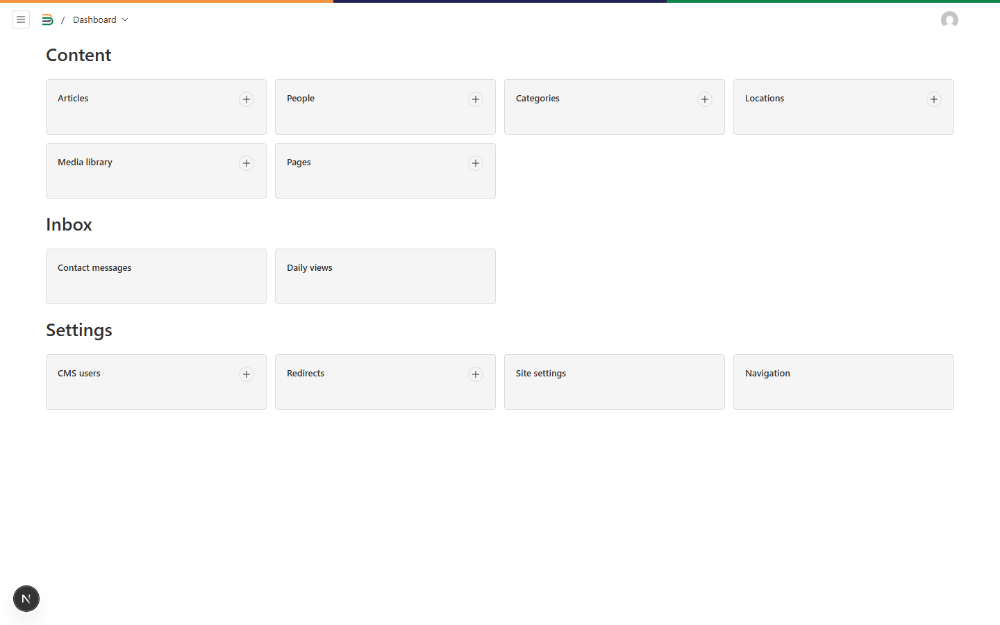
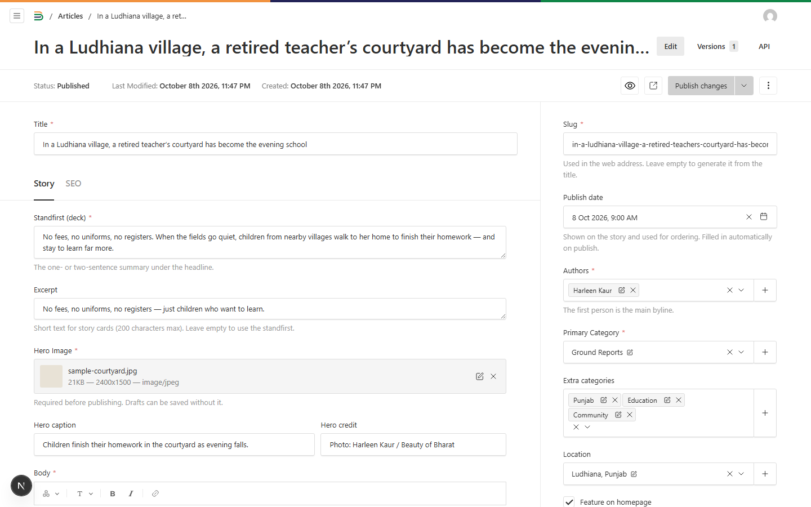
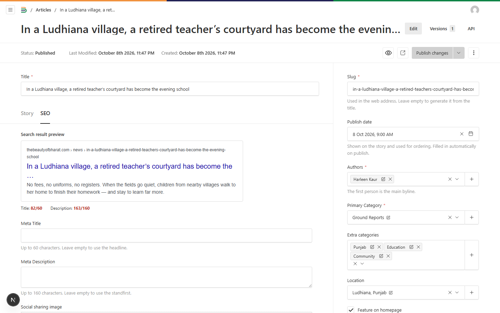
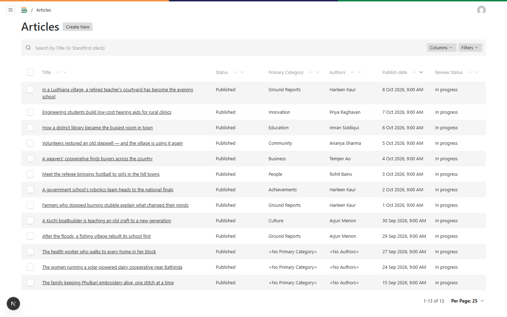
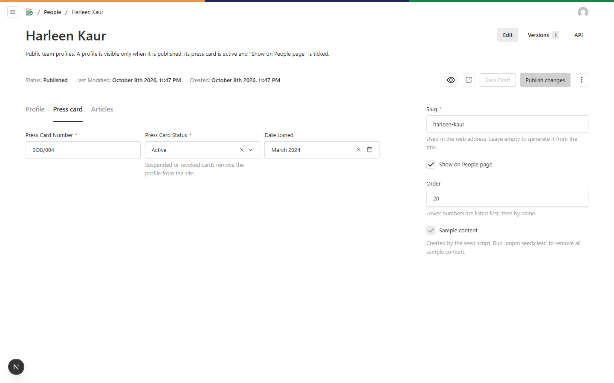
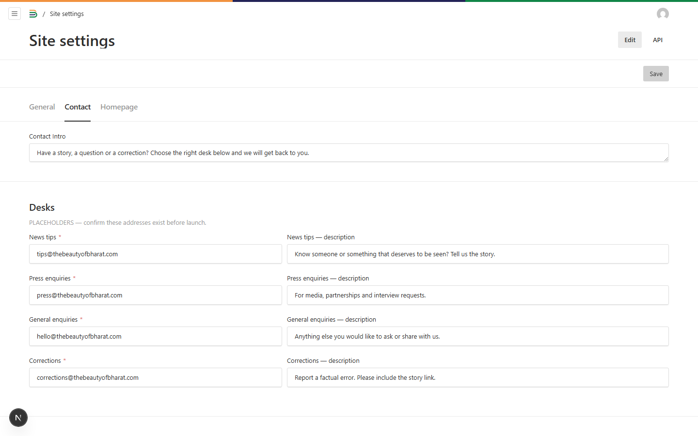
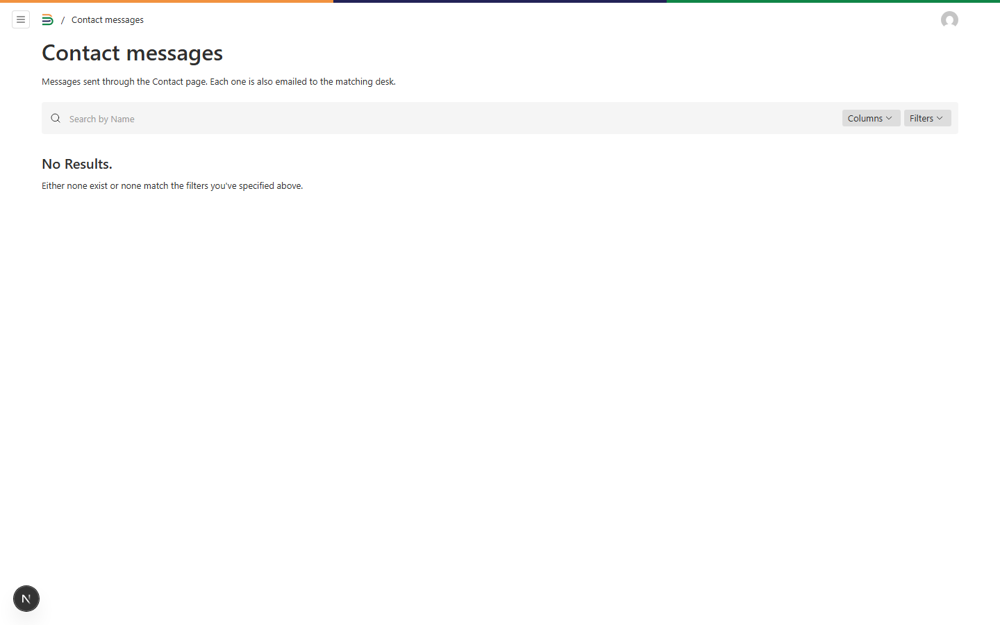

# Editor guide

Everything on the website (stories, the team, the About page, contact details) is managed in the
CMS at **thebeautyofbharat.com/admin**. You don't need a developer for any of the tasks below.

## Logging in

Go to **/admin** and sign in with your email and password. If you forget your password, use
**Forgot password?** on the login screen and a reset link will be emailed to you. After 5 wrong
attempts an account is locked for 15 minutes.

Your **role** decides what you can do:

| Role         | Can do                                                                                                                   |
| ------------ | ------------------------------------------------------------------------------------------------------------------------ |
| **Admin**    | Everything, including logins (CMS users) and Site settings                                                               |
| **Editor**   | Write, publish, schedule and unpublish any story; manage people, categories, locations and images; read contact messages |
| **Reporter** | Write drafts of their own stories and upload images. Reporters can't publish: they press **Submit for review**           |

Admins create logins under **Settings → CMS users**. For a reporter, set **Public profile** to their
People entry. That is what lets them edit their own drafts.

## Writing and publishing a story

1. Go to **Content → Articles → Create new**.
2. Fill in the **Title** (headline) and, on the **Story** tab:
   - **Standfirst (deck)**: the one- or two-sentence summary under the headline.
   - **Excerpt** (optional): shorter text for story cards. Leave it empty to use the standfirst.
   - **Hero image**: the main photo (required before publishing), with its **caption** and **credit**
     (e.g. "Photo: Harleen Kaur / Beauty of Bharat").
   - **Body**: the story itself. Use the toolbar for headings, bold, italic, links and lists. The **+** button adds
     an **Image**, a **Pull quote** or a **Video**.
3. In the right-hand column, choose the **Authors** (the first one is the main byline), the **Primary category**,
   any **Extra categories**, and the **Location**.
4. Tick **Feature on homepage** to lead the homepage with this story. The newest featured story is the lead,
   and the next two featured stories appear beside it.
5. Press **Save draft** at any time (drafts also save automatically). Press **Publish changes** when it is ready.

The **Read time** is worked out automatically. The **Publish date** is filled in when you publish; you can change
it if a story should show a different date.

**Previewing:** the eye icon at the top opens **Live preview** beside the editor, updating as you type. The
square-arrow icon opens the draft on the real site in a new tab (with a blue "Preview" bar; only logged-in users can see it).

**Search engines and sharing:** the **SEO** tab shows how the story will look in Google, with character counters
(title up to 60, description up to 160). Leave the fields empty to use the headline and standfirst. "Social sharing
image" overrides the hero image on WhatsApp, Facebook and X. **Hide from search engines** keeps a story out of Google,
the sitemaps and RSS.

### For reporters: Submit for review

Write your draft and press **Submit for review** in the right-hand column, then **Save draft**. Editors filter the
article list by **Review status = Ready for review** to find it. You can't publish or edit a story once it is live;
ask an editor.

### Scheduling a story

Open the draft, click the small arrow next to **Publish changes** and choose **Schedule publish**. Pick the date and
time. The story goes live automatically within five minutes of that time. To cancel, open the same
**Schedule publish** window and delete the scheduled entry.

### Unpublishing

Click the **⋮** menu at the top right of the story and choose **Unpublish**. The story disappears from every page, the
sitemap and RSS straight away, and its address shows "page not found". Publish it again at any time.

### Correcting a published story

Edit, then **Publish changes**. If the change matters to readers, tick **Show "Updated" date** so the story shows
"Updated [date]" next to the original date. If you change the story's address (**Slug**), the old address keeps
working: readers are redirected to the new one.

## Images

Every image needs **alt text**: a short description of what the photo shows, for readers who can't see it
(e.g. "Children doing homework in a courtyard at dusk"). Add a **caption** and **credit** where relevant.

After uploading, click the image and use the **focal point** (drag the dot onto the subject's face or the most
important part). Cards crop to 16:10 and portraits to 4:5 around that point; the size previews show each crop.

**Adding an image inside a story:** in the Body, press **+** → **Image**, choose or upload the picture, add the
caption and credit, and pick **Column width** or **Wide** (wider than the text).

## Embedding a video

In the Body, press **+** → **Video** and paste a **YouTube**, **Vimeo** or **Instagram** (post or reel) link.
Optionally add a caption, the duration (e.g. "3:12") and a **poster** image. Readers see the poster and a play
button; nothing loads from YouTube or Vimeo until they press play. Links from other sites are refused.

## The team (People)

Go to **Content → People**.

- **Add a person:** **Create new**, then fill in name, designation (e.g. "Punjab Correspondent"), role type (used for
  the People page filters), location, photo (a real photo of the person, with the focal point on their face), a
  short bio (up to 240 characters, for the card) and an optional longer bio. Add social links and an email.
  On the **Press card** tab, enter the card number (e.g. BOB/016), status and date joined. Then **Publish**.
- **Order:** lower **Order** numbers appear first on the People page; ties are sorted by name.
- **Hide someone:** untick **Show on People page** and publish. Their profile disappears from the site, but
  their bylines remain on stories they wrote (without a link).
- **Revoke or suspend a press card:** on the **Press card** tab, set **Status** to _Revoked_ or _Suspended_ and
  publish. The profile is removed from the site immediately, so nobody can use it to claim they represent
  Beauty of Bharat.
- The **Articles** tab lists every story the person has written.

## Categories and locations

**Content → Categories:** add, rename or reorder sections. **Order** controls the order in the category bar under
the header; untick **Show in the category bar** to hide one from the bar (its page still works).
**Content → Locations:** places shown as "Ludhiana, Punjab".

## About, Privacy and Terms

**Content → Pages.** The About page is built from blocks (statement, two-column text, numbered list, cards and the
closing buttons). Edit the text in place, or add, remove and reorder blocks. Privacy and Terms use a single text
block. Publish to update the site.

## Contact details and homepage settings

**Settings → Site settings** (admins only):

- **General:** tagline, the homepage mission line (wrap words in `*asterisks*` to italicise them), the "No paywall"
  line, social links (header, footer, Contact page), and the default sharing image.
- **Contact:** the four desk email addresses and their descriptions, the WhatsApp number (include +91) and the
  WhatsApp channel link.
- **Homepage:** how many stories appear in "Latest news", which category feeds "Ground reports", the "Most read"
  list (pick up to five stories, or switch on the private view counter), and whether to show the people and
  news-tip bands.

**Settings → Navigation:** the header and footer links.

## Reading contact messages

**Inbox → Contact messages** lists everything sent through the Contact page, newest first. Each message is also
emailed to the matching desk. Set **Status** to _In progress_ or _Done_ to keep track; filter the list by status
or topic. Corrections include the link to the story.

## Sample content

Before launch, a developer runs `pnpm seed:clear` to delete the sample stories, people and images (they are marked
"Sample content" in the right-hand column). Categories, locations and the About page are kept.
